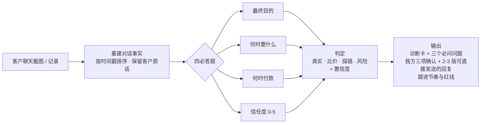
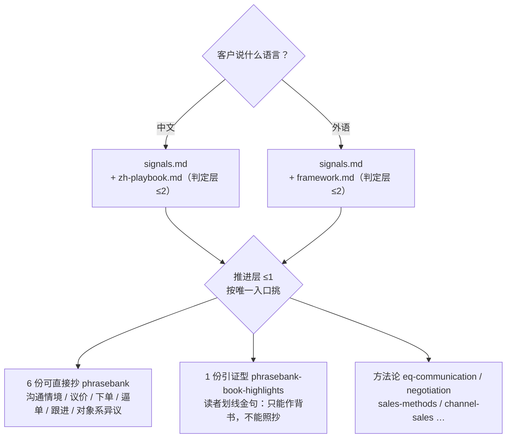
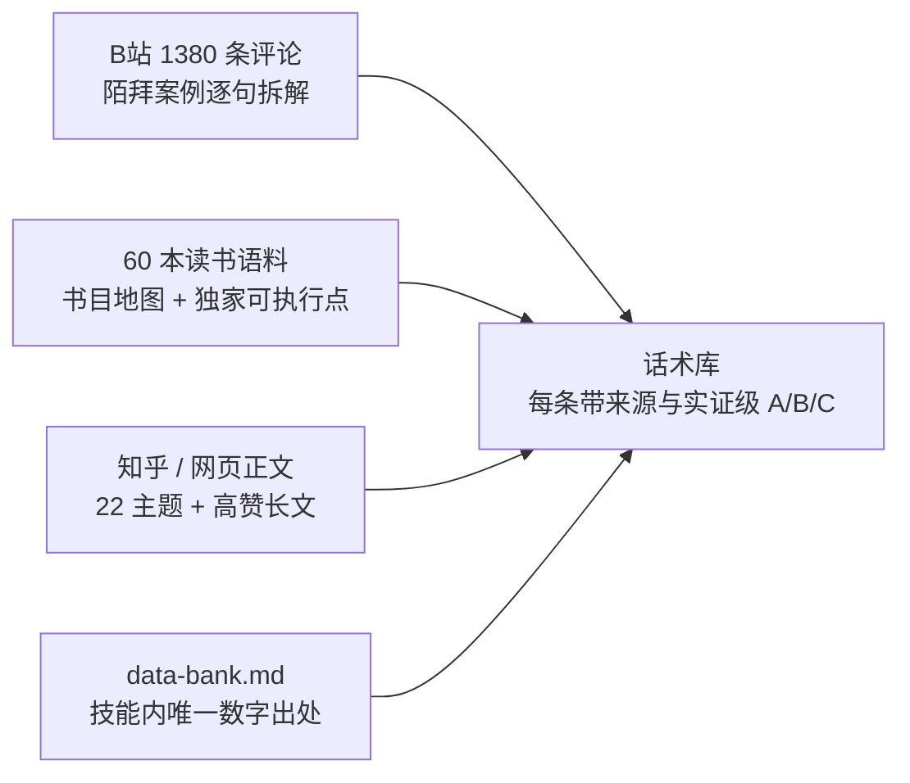

# trade-chat-coach 销冠教练技能

> 从客户聊天截图/记录读出真实意图（真买 / 比价 / 探路 / 风险），给出能推进到下单的下一步动作与可直接发送的话术。
> **国内销售优先，外贸同样适用。** 实证语料 + 中英俄 + 六语言 + 三种运行模式 + 合规红线过滤。

[](CHANGELOG.md)
[](#验证体系)
[](#验证体系)
[](LICENSE)

## 这是什么

一个 AI 技能（SKILL.md + **28 个参考文件**），让任何支持 Agent Skills 的 AI 助手变成销售教练：丢给它一段客户聊天，它先**判断**、再**给话术**——而不是寒暄式地复述你的问题。

## 核心流程



> 判定完成之前**不许取用任何话术**——这是本技能的第一铁律。混合型文件（如 zh-playbook 同时含信号与话术）"允许先读，禁止先用"。

## 28 个参考文件怎么读（全程 ≤3 个，硬预算）



## 三种运行模式

| 模式 | 触发说法 | 输出 |
|---|---|---|
| **实战**（默认） | 丢截图 + "帮我看看这个客户" | 8 段诊断卡 + 2-3 版回复 + 跟进节奏 |
| **批量** | "这几个客户一起看看" | 每客户 4 行卡 + P1/P2/P3 优先级总表 |
| **实时** | "快帮我回：客户刚说……" | 2-3 条即发回复 + 每条一句用意 |
| **单点咨询** | 问一件事，无具体客户 | 1-3 句能用 + 一句依据 + 一句红线 |

## 语料与实证



> 引用任何百分比前先查 `data-bank.md`；读者划线金句引用时必须注明**划线人数 + 书名**（读者行为数据 ≠ 内容正确性证明）。

## 目录结构

```
trade-chat-coach/
├── SKILL.md            # 主文件：五步流程 + 三模式 + 参考路由表（带仲裁规则）
├── references/          # 28 个参考文件（按需读取，全程 ≤3 个硬预算）
│   ├── signals.md               # 信号词典（真买/比价/探路/风险）
│   ├── framework.md             # 四必答题/承诺阶梯/信任度/P1-P2-P3
│   ├── zh-playbook.md           # 中文场景 S1-S16 + 内贸风险与合规
│   ├── playbook.md              # 英文场景 12 剧本
│   ├── i18n-phrases.md          # 六语言外贸短句
│   ├── objections.md            # 异议处理话术 + 成交信号/推进
│   ├── eq-communication.md      # 高情商句式 20 条 + 实证依据
│   ├── templates.md             # D0→D21 完整模板
│   ├── sales-methods.md         # SPIN/挑战者/MEDDIC/铁军/LTC
│   ├── negotiation.md           # 让步阶梯/BATNA/锚定
│   ├── influence.md             # 影响力与行为科学 + 伦理边界
│   ├── channel-sales.md         # 渠道销售方法论
│   ├── video-corpus.md          # B站语料实证
│   ├── bili-corpus-2026-10.md   # B站 1380 条语料（陌拜案例逐句拆解）
│   ├── web-corpus.md            # 外贸网页实证（22 主题）
│   ├── domestic-corpus.md       # 国内销售实证 + 催款函三级递进
│   ├── courses.md               # 课程/书单/知乎高赞
│   ├── sources.md               # 来源书目与数据可靠性（A/B/C / 禁引用清单）
│   ├── data-bank.md             # 证据与数据总表（唯一数字出处）
│   ├── book-corpus-sales-negotiation.md  # 销售与谈判书目方法论库
│   ├── book-corpus-communication-eq.md   # 沟通与情商书目方法论库
│   ├── phrasebank-eq-cn.md      # ★ 可直接抄｜高情商沟通话术库（11 类情境）
│   ├── phrasebank-price.md      # ★ 可直接抄｜价格异议与议价话术库
│   ├── phrasebank-closing.md    # ★ 可直接抄｜引导下单话术库
│   ├── phrasebank-bidan.md      # ★ 可直接抄｜逼单与成交转译公式
│   ├── phrasebank-followup.md   # ★ 可直接抄｜跟进与报价后破冰
│   ├── phrasebank-objections-cn.md # ★ 可直接抄｜8 类对象系异议（交期/质量/账期…）
│   └── phrasebank-book-highlights.md # ☆ 引证型｜读者划线金句（只能作背书，不能照抄）
└── evals/
    ├── evals.json        # 11 个评测用例（含 expectations 断言）
    └── fixtures/         # 8 张评测夹具截图（中英俄三语）
```

> ★ = **6 份可直接抄**的原话术库；☆ = 第 7 份**引证型**（须注明划线人数与书名，**不能直接发出去**）。
> `.skill` 包按官方打包器约定**排除 `evals/`**；评测资产随源码仓库与整包 zip 分发。

## 验证体系（四层，逐层加压，全部接入发布流水线）

| 层 | 工具 | 断言数 | 查什么 |
|---|---|---|---|
| 1 结构 | `validate_skill_full.py` | **44** | frontmatter / 引用完整性 / Evals 资产 / 编码行尾 / 内容一致性 / 发布就绪 |
| 2 上游契约 | 官方 `quick_validate.py` | — | frontmatter 白名单键 + 描述长度（须 `PYTHONUTF8=1`） |
| 3 产物 | `verify_artifact.py` | — | `.skill`/zip 顶层唯一、refs 与 fixtures **动态对齐源目录**、CRC |
| 4 行为路由 | `smoke_e2e.py` | **65** | 28 个引用可解析、章节锚点真存在、9 类提问一步定位、术语有定义、红线成章 |

任一层不过，发布流水线即中止并回滚——坏包到不了 Releases。

## 快速开始

1. 从 [Releases](https://github.com/Asaceoo/trade-chat-coach-skills/releases/latest) 下载最新 `trade-chat-coach.skill`（或整包 zip），或克隆本仓库
2. 把 `trade-chat-coach/` 目录放入你的 Agent 技能目录（如 Claude Code: `~/.claude/skills/`）
3. 对 AI 说：*帮我看看这个客户是不是真要买* + 丢一张聊天截图

详细用法见 [使用手册.md](使用手册.md)，技术架构见 [README_技术手册.md](README_技术手册.md)。

## 红线（内置）

技能显式拒绝：演戏逼单（假库存/假稀缺）、编造资质与客户案例、消费信贷式催收施压、以礼品/宴请或回扣换取采购决策。
判断永远给置信度与"错在哪"——**是概率，不是判决**。

## 版本

| 版本 | 要点 |
|---|---|
| **v2.10.x** | 读书语料层四源合一 + 金句库引证化 + 发布链路六轮对抗性审查（清单 39→44、产物校验入管道、自动补行） |
| v2.9.x | 三重对抗性审查收敛 + 扩展键收进 metadata + 赞数纠错 |
| **v2.8.0** | 3 份原话术库 + B站 1380 条语料实证层 + 发布流水线 v2 |
| v2.6.x–2.7.x | 对抗性审查收敛 + GitHub 开源发布 + 知乎正文入库 |

完整变更见 [CHANGELOG.md](CHANGELOG.md)。

## License

MIT